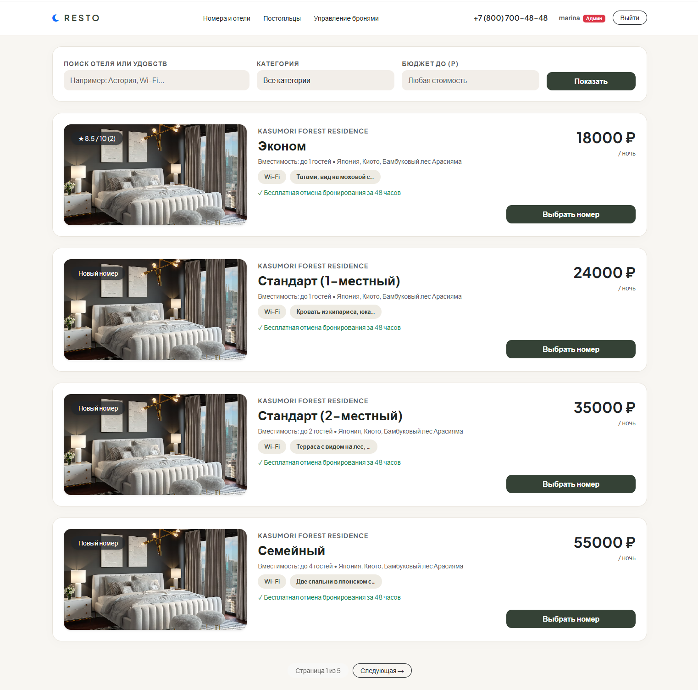
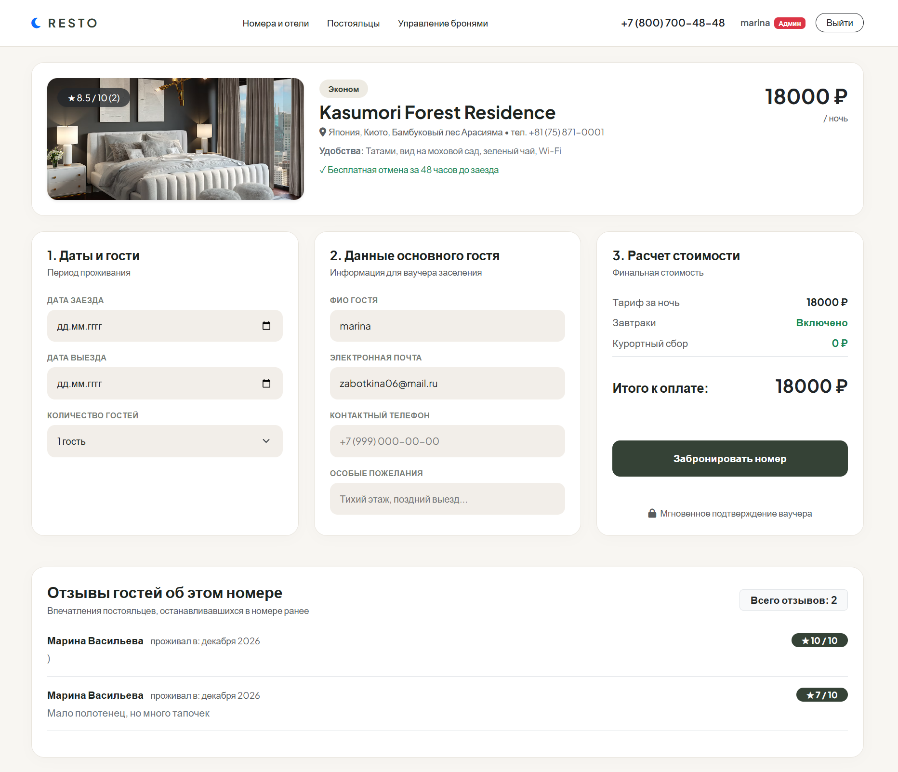
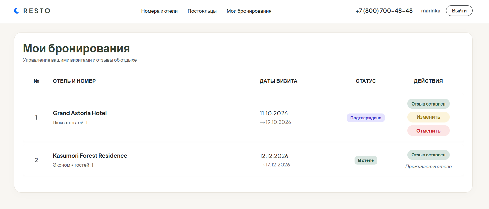
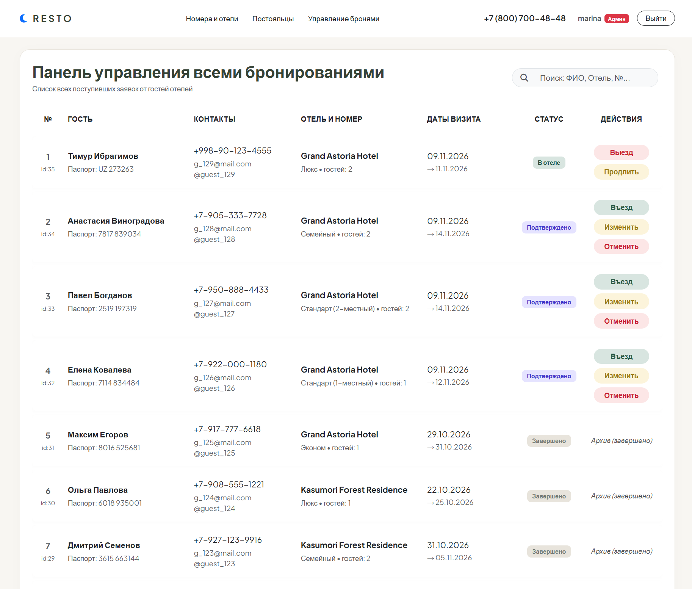
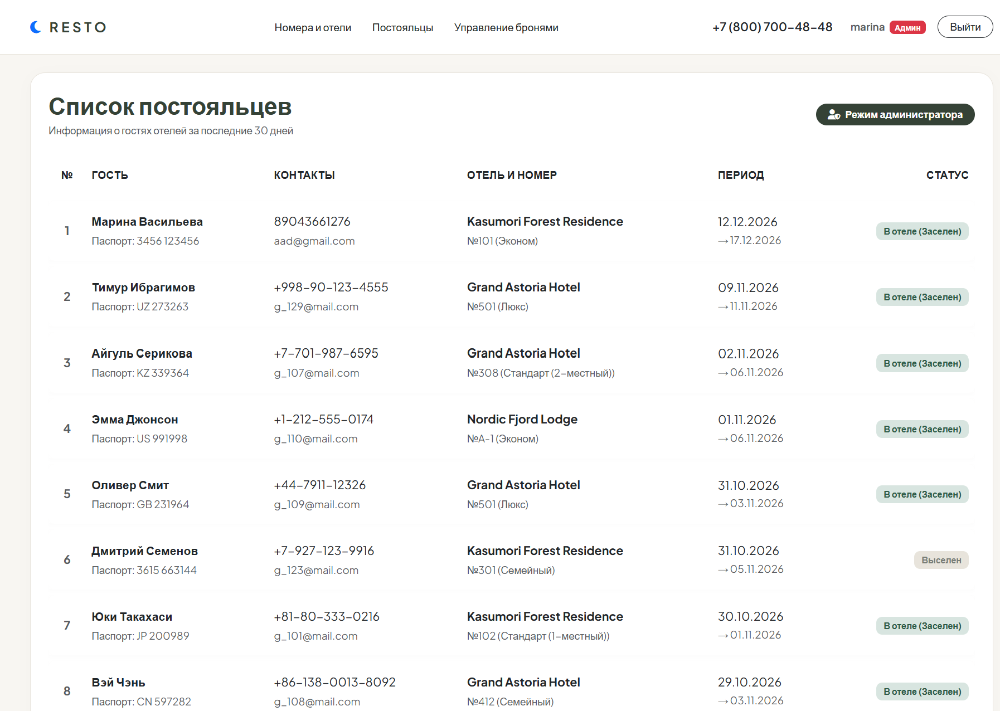
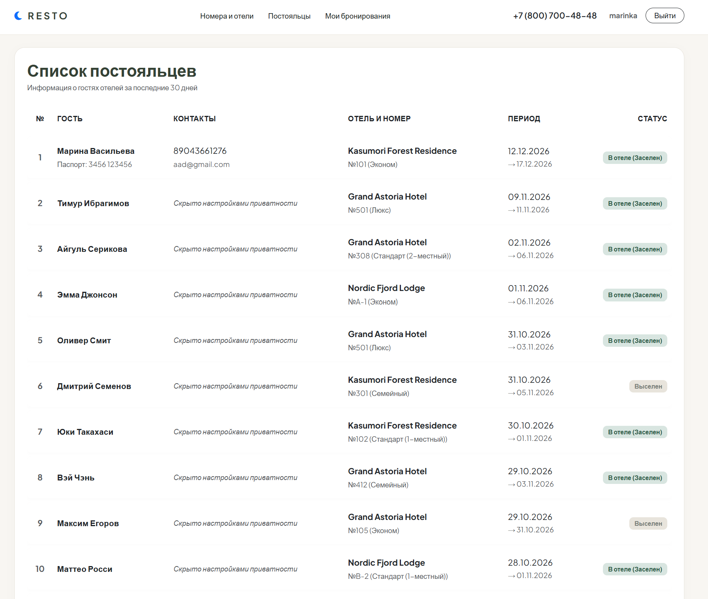
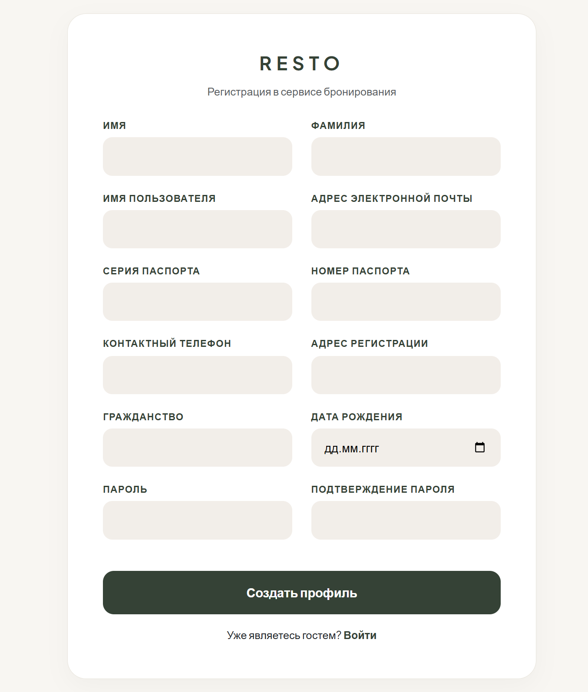
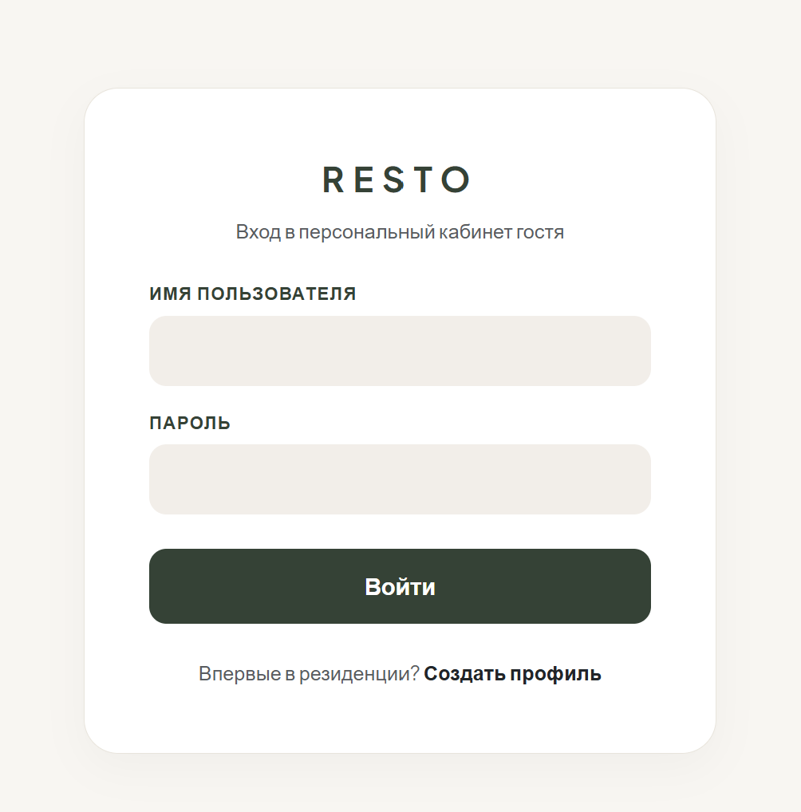

# Лабораторная работа №2: Реализация простого сайта средствами Django

* **Выполнила:** Заботкина Марина
* **Группа:** К3339
* **Вариант:** 1 (Список отелей)

---

**Цель работы:** овладеть практическими навыками и умениями реализации web-сервисов средствами Django.

### Требования к заданию:
Необходимо учитывать название отеля, владельца отеля, адрес, описание, типы номеров, стоимость, вместимость, удобства.

**Обязательный функционал:**
1. Регистрация новых пользователей.
2. Просмотр и резервирование номеров. Пользователь должен иметь возможность редактирования и удаления своих резервирований.
3. Написание отзывов к номерам (с сохранением периода проживания, текста отзыва, рейтинга по шкале 1–10 и автора).
4. Заселение и выселение пользователей администратором.
5. Формирование клиентской таблицы со списком постояльцев отеля за последний месяц.

## 1. Структура проекта

```text
hotel_project/
├── hotel_app/                  # Основное приложение отелей
│   ├── models.py               # Реляционные модели базы данных
│   ├── admin.py                # Панель управления и действия администратора
│   ├── forms.py                # Классы форм 
│   ├── views.py                # Контроллеры
│   └── urls.py                 # Маршрутизация URL
├── hotel_project/              # Конфигурация проекта
│   ├── settings.py             # Настройки
│   └── urls.py                 # Главный роутер проекта
└── templates/                  # Клиентские HTML-шаблоны
    ├── base.html               # Базовый каркас сайта и навигация
    ├── room_list.html          # Каталог номеров
    ├── room_detail.html        # Карточка номера, бронь и отзывы
    ├── my_bookings.html        # Мои брони (гость) / Диспетчерская панель (админ)
    ├── guest_list.html         # Таблица постояльцев за последний месяц
    ├── register.html           # Страница регистрации гостя
    ├── login.html              # Страница входа в личный кабинет
    ├── booking_form.html       # Форма изменения дат и состава гостей
    └── booking_confirm_delete.html # Подтверждение отмены брони
```

## 2. Код

### Модели базы данных (`hotel_app/models.py`)
Описана структура реляционной БД. Модель `User` расширена полями паспорта, телефона и адреса на базе `AbstractUser`.  
Созданы связанные сущности `Hotel`, `Room`, `Booking` и `Review` с методами расчета рейтинга и привязки изображений:

```python
from django.contrib.auth.models import AbstractUser
from django.db import models


class User(AbstractUser):
    phone_number = models.CharField(max_length=20, blank=True, null=True, verbose_name="Контактный телефон")
    passport_series = models.CharField(max_length=4, blank=True, null=True, verbose_name="Серия паспорта")
    passport_number = models.CharField(max_length=6, blank=True, null=True, verbose_name="Номер паспорта")
    home_address = models.CharField(max_length=255, blank=True, null=True, verbose_name="Адрес регистрации")
    nationality = models.CharField(max_length=50, blank=True, null=True, default="РФ", verbose_name="Гражданство")
    birth_date = models.DateField(blank=True, null=True, verbose_name="Дата рождения")

    def __str__(self):
        return f"{self.last_name} {self.first_name} ({self.username})"


class Hotel(models.Model):
    name = models.CharField(max_length=150, verbose_name="Название отеля")
    owner = models.ForeignKey(User, on_delete=models.CASCADE, related_name="hotels", verbose_name="Владелец отеля")
    address = models.CharField(max_length=255, verbose_name="Адрес")
    phone_number = models.CharField(max_length=20, verbose_name="Телефон ресепшена")
    description = models.TextField(verbose_name="Описание отеля")

    def __str__(self):
        return self.name


class Room(models.Model):
    ROOM_TYPES = (
        ("ECO", "Эконом"),
        ("STD_1", "Стандарт (1-местный)"),
        ("STD_2", "Стандарт (2-местный)"),
        ("FML", "Семейный"),
        ("LUX", "Люкс"),
    )
    hotel = models.ForeignKey(Hotel, on_delete=models.CASCADE, related_name="rooms", verbose_name="Отель")
    room_number = models.CharField(max_length=10, verbose_name="Номер комнаты")
    room_type = models.CharField(max_length=10, choices=ROOM_TYPES, verbose_name="Тип номера")
    price_per_night = models.DecimalField(max_digits=10, decimal_places=2, verbose_name="Цена за сутки (руб.)")
    capacity = models.IntegerField(verbose_name="Вместимость (чел.)")
    amenities = models.TextField(verbose_name="Удобства (Wi-Fi, ТВ, Кондиционер)")
    image_url = models.URLField(blank=True, null=True, verbose_name="Ссылка на фото", default="https://images.pexels.com/photos/164595/pexels-photo-164595.jpeg?auto=compress&cs=tinysrgb&w=1260&h=750&dpr=1")

    def get_photo_url(self):
        if self.image_url and self.image_url.strip():
            return self.image_url.strip()
        return "https://images.pexels.com/photos/164595/pexels-photo-164595.jpeg?auto=compress&cs=tinysrgb&w=1260&h=750&dpr=1"

    def get_rating(self):
        reviews = self.reviews.all()
        if reviews.exists():
            avg = sum(r.rating for r in reviews) / reviews.count()
            return f"{avg:.1f}"
        return None

    def __str__(self):
        return f"{self.hotel.name} — №{self.room_number} ({self.get_room_type_display()})"


class Booking(models.Model):
    STATUS_CHOICES = (
        ("BOOKED", "Забронировано"),
        ("CHECKED_IN", "Заселен в отель"),
        ("CHECKED_OUT", "Выселен из отеля"),
    )
    user = models.ForeignKey(User, on_delete=models.CASCADE, related_name="bookings", verbose_name="Клиент")
    room = models.ForeignKey(Room, on_delete=models.CASCADE, related_name="bookings", verbose_name="Номер")
    check_in_date = models.DateField(verbose_name="Дата заезда")
    check_out_date = models.DateField(verbose_name="Дата выезда")
    status = models.CharField(max_length=15, choices=STATUS_CHOICES, default="BOOKED", verbose_name="Статус проживания")
    guests_count = models.PositiveIntegerField(default=1, verbose_name="Количество гостей")

    def has_review(self):
        return Review.objects.filter(author=self.user, room=self.room).exists()

    def __str__(self):
        return f"Бронь #{self.id}: {self.user} ({self.room})"


class Review(models.Model):
    RATING_CHOICES = [(i, str(i)) for i in range(1, 11)]
    author = models.ForeignKey(User, on_delete=models.CASCADE, verbose_name="Автор")
    room = models.ForeignKey(Room, on_delete=models.CASCADE, related_name="reviews", verbose_name="Номер")
    stay_period = models.CharField(max_length=100, verbose_name="Период проживания")
    text = models.TextField(verbose_name="Текст отзыва")
    rating = models.IntegerField(choices=RATING_CHOICES, verbose_name="Оценка (1-10)")

    def __str__(self):
        return f"Отзыв от {self.author} к {self.room} ({self.rating}/10)"
```

### Настройка панели администратора (`hotel_app/admin.py`)
Регистрация моделей с расширением интерфейса пользователя через `UserAdmin`:

```python
from django.contrib import admin
from django.contrib.auth.admin import UserAdmin
from .models import Booking, Hotel, Review, Room, User


class CustomUserAdmin(UserAdmin):
    fieldsets = UserAdmin.fieldsets + (
        (
            "Паспортные данные и контакты",
            {
                "fields": (
                    "phone_number",
                    "passport_series",
                    "passport_number",
                    "home_address",
                    "nationality",
                    "birth_date",
                )
            },
        ),
    )


admin.site.register(User, CustomUserAdmin)
admin.site.register(Hotel)
admin.site.register(Room)
admin.site.register(Booking)
admin.site.register(Review)
```

### Формы приложения (`hotel_app/forms.py`)
Описаны формы регистрации пользователя, бронирования номеров и отправки отзывов:

```python
from django import forms
from django.contrib.auth.forms import UserCreationForm
from .models import Booking, Review, User


class RegisterForm(UserCreationForm):

    class Meta(UserCreationForm.Meta):
        model = User
        fields = (
            "first_name",
            "last_name",
            "username",
            "email",
            "passport_series",
            "passport_number",
            "phone_number",
            "home_address",
            "nationality",
            "birth_date",
        )
        widgets = {"birth_date": forms.DateInput(attrs={"type": "date"})}


class BookingForm(forms.ModelForm):
    first_name = forms.CharField(label="Имя гостя", required=False)
    last_name = forms.CharField(label="Фамилия гостя", required=False)
    phone_number = forms.CharField(label="Контактный телефон", required=False)

    class Meta:
        model = Booking
        fields = [
            "check_in_date",
            "check_out_date",
            "guests_count",
            "first_name",
            "last_name",
            "phone_number",
        ]
        widgets = {
            "check_in_date": forms.DateInput(attrs={"type": "date"}),
            "check_out_date": forms.DateInput(attrs={"type": "date"}),
            "guests_count": forms.NumberInput(attrs={"min": 1, "max": 4}),
        }

    def __init__(self, *args, **kwargs):
        super().__init__(*args, **kwargs)
        if self.instance and self.instance.pk and self.instance.user:
            self.fields["first_name"].initial = self.instance.user.first_name
            self.fields["last_name"].initial = self.instance.user.last_name
            self.fields["phone_number"].initial = self.instance.user.phone_number

    def save(self, commit=True):
        booking = super().save(commit=commit)
        if booking.user:
            user = booking.user
            user.first_name = self.cleaned_data.get("first_name", user.first_name)
            user.last_name = self.cleaned_data.get("last_name", user.last_name)
            user.phone_number = self.cleaned_data.get("phone_number", user.phone_number)
            user.save()
        return booking


class ReviewForm(forms.ModelForm):

    class Meta:
        model = Review
        fields = ["stay_period", "rating", "text"]
        widgets = {
            "text": forms.Textarea(
                attrs={
                    "rows": 3,
                    "placeholder": "Поделитесь впечатлениями об удобстве, чистоте...",
                }
            ),
        }
```

### Контроллеры и бизнес-логика (`hotel_app/views.py`)
Постраничная пагинация, поиск по нескольким полям, функционал смены статусов и фильтрация по датам:

```python
import datetime
from django.contrib import messages
from django.contrib.auth import login, logout
from django.contrib.auth.mixins import LoginRequiredMixin, UserPassesTestMixin
from django.http import Http404
from django.shortcuts import redirect, render
from django.views.generic import DeleteView, ListView, UpdateView
from .forms import BookingForm, RegisterForm, ReviewForm
from .models import Booking, Review, Room


def register_view(request):
    if request.method == "POST":
        form = RegisterForm(request.POST)
        if form.is_valid():
            user = form.save()
            login(request, user)
            messages.success(request, "Регистрация прошла успешно!")
            return redirect("room_list")
    else:
        form = RegisterForm()
    return render(request, "register.html", {"form": form})


def logout_view(request):
    logout(request)
    return redirect("/")


class RoomListView(ListView):
    model = Room
    template_name = "room_list.html"
    context_object_name = "rooms"
    paginate_by = 4

    def get_queryset(self):
        queryset = Room.objects.all()

        search_query = self.request.GET.get("search")
        if search_query:
            q1 = queryset.filter(hotel__name__icontains=search_query)
            q2 = queryset.filter(amenities__icontains=search_query)
            q3 = queryset.filter(room_number__icontains=search_query)
            queryset = q1 | q2 | q3

        room_type = self.request.GET.get("room_type")
        if room_type:
            queryset = queryset.filter(room_type=room_type)

        max_price = self.request.GET.get("max_price")
        if max_price:
            queryset = queryset.filter(price_per_night__lte=max_price)

        return queryset

    def get_context_data(self, **kwargs):
        context = super().get_context_data(**kwargs)
        context["room_types"] = Room.ROOM_TYPES
        return context


def room_detail_view(request, pk):
    try:
        room = Room.objects.get(pk=pk)
    except Room.DoesNotExist:
        raise Http404("Room does not exist")

    reviews = room.reviews.all().order_by("-id")
    booking_form = BookingForm()

    if request.method == "POST" and "book_room" in request.POST:
        if not request.user.is_authenticated:
            return redirect("login")
        booking_form = BookingForm(request.POST)
        if booking_form.is_valid():
            booking = booking_form.save(commit=False)
            booking.user = request.user
            booking.room = room
            booking.save()
            messages.success(request, "Номер успешно забронирован!")
            return redirect("my_bookings")

    if request.method == "POST" and "send_review" in request.POST:
        if not request.user.is_authenticated:
            return redirect("login")

        existing_review = Review.objects.filter(
            author=request.user, room=room
        ).first()
        review_form = ReviewForm(request.POST, instance=existing_review)

        if review_form.is_valid():
            review = review_form.save(commit=False)
            review.author = request.user
            review.room = room
            review.save()

            if existing_review:
                messages.success(request, "Ваш отзыв успешно обновлен!")
            else:
                messages.success(request, "Спасибо! Ваш отзыв опубликован!")
            return redirect("room_detail", pk=room.pk)

    return render(
        request,
        "room_detail.html",
        {
            "room": room,
            "reviews": reviews,
            "booking_form": booking_form,
        },
    )


class MyBookingsView(LoginRequiredMixin, ListView):
    model = Booking
    template_name = "my_bookings.html"
    context_object_name = "bookings"
    paginate_by = 15

    def get_queryset(self):
        if self.request.user.is_staff:
            queryset = Booking.objects.all().order_by("-id")
            search_query = self.request.GET.get("search")
            if search_query:
                if search_query.isdigit():
                    queryset = queryset.filter(id=search_query)
                else:
                    q1 = queryset.filter(user__first_name__icontains=search_query)
                    q2 = queryset.filter(user__last_name__icontains=search_query)
                    q3 = queryset.filter(room__hotel__name__icontains=search_query)
                    queryset = q1 | q2 | q3
            return queryset

        return Booking.objects.filter(user=self.request.user).order_by("-id")


class BookingUpdateView(LoginRequiredMixin, UserPassesTestMixin, UpdateView):
    model = Booking
    form_class = BookingForm
    template_name = "booking_form.html"
    success_url = "/my-bookings/"

    def test_func(self):
        booking = self.get_object()
        return self.request.user == booking.user or self.request.user.is_staff


class BookingDeleteView(LoginRequiredMixin, UserPassesTestMixin, DeleteView):
    model = Booking
    template_name = "booking_confirm_delete.html"
    success_url = "/my-bookings/"

    def test_func(self):
        booking = self.get_object()
        return self.request.user == booking.user or self.request.user.is_staff


class GuestListView(ListView):
    model = Booking
    template_name = "guest_list.html"
    context_object_name = "recent_guests"
    paginate_by = 15

    def get_queryset(self):
        one_month_ago = datetime.datetime.now().date() - datetime.timedelta(days=30)
        return Booking.objects.filter(
            status__in=["CHECKED_IN", "CHECKED_OUT"],
            check_in_date__gte=one_month_ago,
        ).order_by("-check_in_date")


def change_booking_status(request, pk, status):
    if not request.user.is_staff:
        messages.error(request, "Недостаточно прав!")
        return redirect("my_bookings")

    try:
        booking = Booking.objects.get(pk=pk)
    except Booking.DoesNotExist:
        raise Http404("Booking does not exist")

    if status in dict(Booking.STATUS_CHOICES):
        booking.status = status
        booking.save()
        messages.success(request, f"Статус брони #{booking.id} обновлен!")

    return redirect("my_bookings")
```

### Маршрутизация URL (`hotel_app/urls.py` и `hotel_project/urls.py`)

**Файл `hotel_app/urls.py`:**
```python
from django.contrib.auth import views as auth_views
from django.urls import path
from . import views

urlpatterns = [
    path("", views.RoomListView.as_view(), name="room_list"),
    path("room/<int:pk>/", views.room_detail_view, name="room_detail"),
    path("register/", views.register_view, name="register"),
    path(
        "login/",
        auth_views.LoginView.as_view(template_name="login.html"),
        name="login",
    ),
    path("logout/", views.logout_view, name="logout"),
    path("my-bookings/", views.MyBookingsView.as_view(), name="my_bookings"),
    path(
        "booking/<int:pk>/edit/",
        views.BookingUpdateView.as_view(),
        name="booking_edit",
    ),
    path(
        "booking/<int:pk>/delete/",
        views.BookingDeleteView.as_view(),
        name="booking_delete",
    ),
    path("guests/", views.GuestListView.as_view(), name="guest_list"),
    path(
        "booking/<int:pk>/status/<str:status>/",
        views.change_booking_status,
        name="change_status",
    ),
]
```

**Файл `hotel_project/urls.py`:**
```python
from django.contrib import admin
from django.urls import include, path

urlpatterns = [
    path("admin/", admin.site.urls),
    path("", include("hotel_app.urls")),
]
```

## 3. Результаты работы 
### Каталог номеров отелей
Главная страница сервиса RESTO. Реализована фильтрация по бюджету, категории номера, текстовый поиск и постраничная пагинация (по 4 номера на страницу):



### Форма бронирования
Страница оформления проживания в 3 колонки: выбор дат визита и количества гостей, редактирование контактов гостя и расчет стоимости:



### Страница с бронированиями
Отображение личных поездок гостя, редактирование дат или отмена активной брони. Написание отзыва по 10-балльной шкале (повторный отзыв блокируется):



### Панель управления бронированиями для администратора
Администратор видит брони всех гостей, их контакты, строку поиска и кнопки оперативного заселения/выселения:



### Список постояльцев отеля за последний месяц
Отображает гостей, проживавших в отелях за последние 30 дней. Реализовано разграничение прав доступа: конфиденциальные контакты и паспорта скрыты от обычных пользователей и видны только администратору:





### Регистрация и вход





## 5. Вывод
В ходе выполнения лабораторной работы №2 был разработан web-сервис бронирования отелей RESTO на базе фреймворка Django:
1. Спроектирована база данных со связанными сущностями (`Hotel`, `Room`, `Booking`, `Review`) и расширением стандартного пользователя `AbstractUser`.
2. Реализована бизнес-логика резервирования номеров, изменения данных ваучера и отмены броней на базе классов-дженериков (`ListView`, `UpdateView`, `DeleteView`).
3. Разработана система отзывов с валидацией дубликатов и рейтингом от 1 до 10.
4. Интерфейс стилизован с использованием библиотеки Bootstrap 5.
5. Реализована постраничная пагинация для разделов.
6. Настроен поиск и фильтрация объектов с сохранением параметров при переходе по страницам.